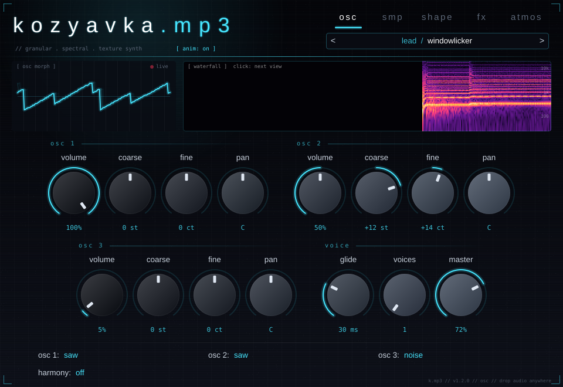
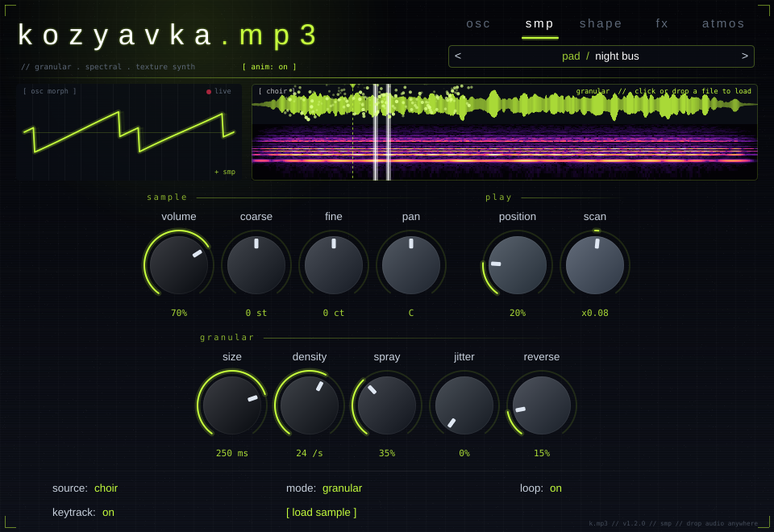

# kozyavka.mp3

Экспериментальный синтезатор (VST3) для FL Studio. В нём три осциллятора, сэмплер с гранулярным
и спектральным режимами, генератор атмосферы и цепочка эффектов для звукового дизайна.
Интерфейс анимированный: глитч-заголовок, «живая» волна, спектрограмма и разлетающиеся гранулы.




Звуковой пример (8 пресетов подряд): `docs/demo.wav`

## Вкладки

### osc
- **osc 1–3**: громкость, тон (±24 полутона), подстройка, панорама.
  Форма волны выбирается внизу: sine / triangle / saw / square / noise.
- **voice**: глайд, число голосов (1 — моно), общая громкость.
- **harmony**: одна клавиша играет целый аккорд (octave, fifth, power, major, minor, sus2, minor7, sub).

### smp — сэмплер по мотивам Serum 2
Можно взять один из пяти встроенных звуков (glass, choir, metal, breath, vox) или загрузить свой
файл (wav / aiff / flac / mp3 / ogg, до 30 секунд). Загрузить файл можно кнопкой **[ load sample ]**,
кликом по картинке сэмпла или просто **перетащив файл в окно плагина**.

- **classic**: обычный сэмплер, высота меняется вместе со скоростью.
  - position — точка старта;
  - loop — повтор.
- **granular**: звук рассыпается на облако коротких кусочков.
  - size — длина гранулы;
  - density — сколько гранул в секунду;
  - spray — разброс по сэмплу;
  - jitter — прыжки на октаву или квинту;
  - reverse — доля гранул задом наперёд;
  - scan — скорость движения по сэмплу (0 — стоять на месте, минус — назад).
- **spectral**: звук разбирается на спектр и собирается заново (фазовый вокодер),
  поэтому высота и время независимы.
  - scan 0 — заморозить момент;
  - blur — размыть спектр во времени;
  - shift — сдвинуть все частоты на ±1000 Гц (металл, «нечеловеческий» звук);
  - sparse — оставить только самые сильные обертоны (стеклянный, «призрачный» звук);
  - whisper — превратить в шёпот.

Верхняя картинка показывает волну и спектрограмму сэмпла, белые линии — где сейчас играют голоса,
светящиеся точки — новые гранулы.

### shape
Огибающая ADSR, фильтр (cutoff, resonance, env), LFO, drive (warm / fold / fuzz) и formant (гласные «а-э-и-о-у»).

### fx
- **crush**: биткрашер.
  - bits — разрядность, от 16 до 1;
  - rate — частота дискретизации, от 48 кГц до 200 Гц;
  - mix — доля эффекта.
- **motion**: ритмический гейт под темп проекта (1/4–1/32; smooth / gate / pump).
- **crystal**: реверс-гранулярное эхо с питчем (как Soundtoys Crystallizer).
- **space**: шиммер-реверб: mix, size, predelay, shimmer, color mode, freeze.

### atmos — атмосфера
Типы: wind, vinyl, rain, static (радиоэфир), ocean, fire или sample (свой файл).
Звук генерируется на лету и не повторяется.
- **tone**: тёмный ↔ светлый.
- **density**: частота порывов, капель, щелчков, волн.
- **variation**: насколько звук «гуляет» и меняется.
- **width**: стерео-ширина.
- **seed**: «номер дубля». Каждое значение даёт другой характер записи, **[ regen ]** выбирает случайный.
- **follow**:
  - notes — атмосфера звучит вместе с нотами;
  - always — звучит всегда.
- **[ load texture ]**: свой файл в роли атмосферы, например запись улицы. Он проигрывается длинными
  перекрывающимися кусками со случайных мест, поэтому петля не слышна.
  Файл можно и перетащить в окно, когда открыта вкладка atmos.

### Пресеты
Панель вверху справа: стрелки `<` `>` листают пресеты, клик по имени открывает меню по категориям.
Пресеты видны и в стандартном списке пресетов FL Studio.

| Категория | Пресеты |
|---|---|
| bass (гиперпоп 2019–2022) | gecgec 808, rubber sophie, bitglass sub |
| lead | drukqs acid, petal vox, windowlicker |
| pad | night bus, salem drag, botanica bloom |
| pluck | glass petal, aphex music box, hyper pluck |
| atmosphere | south london rain, witch fog, forest radio |
| spectral | prism choir, ghost freeze, metal bloom |
| granular | vox cloud, glass rain, breath swarm |

### Анимации и слабый компьютер
Анимации работают с частотой 30 кадров в секунду и перерисовывают только свои области.
Надпись **[ anim: on ]** под логотипом выключает их совсем.
Звуковой движок от анимаций не зависит.

Нагрузка (Xeon 2,1 ГГц, одно ядро):

| Ситуация | Загрузка |
|---|---|
| 16 нот, только синтезатор | ~0,7 % |
| 16 нот в режиме granular | ~3,6 % |
| 16 нот в режиме spectral | ~8,5 % |
| любой пресет, аккорд из 3 нот | 0,1–3,6 % |

Эффект с ручкой на нуле и выключенный слой сэмплера процессор не тратят вообще.

---

## Как получить плагин

Плагин собирается автоматически на GitHub при каждом изменении в репозитории.

1. Откройте вкладку **Actions** в репозитории и выберите последний запуск **Build Windows VST3** с зелёной галочкой.
2. Внизу, в разделе **Artifacts**, скачайте **Kozyavka-Windows**.
3. Распакуйте архив и скопируйте папку `VST3\Kozyavka.mp3.vst3` целиком в `C:\Program Files\Common Files\VST3\`.
   Старую папку `Mini 3xOsc.vst3`, если она там есть, можно удалить.
4. Во FL Studio откройте **Options → Manage plugins → Find installed plugins** и отметьте «Kozyavka.mp3» звёздочкой.

В папке `Standalone` лежит `Kozyavka.mp3.exe`. Это тот же синтезатор отдельной программой, для быстрой проверки.

## Сборка на своём компьютере (по желанию)

1. Установите **Visual Studio 2022** с нагрузкой «Разработка классических приложений на C++».
2. В **Developer PowerShell for VS** выполните:
   ```
   cmake -B build -G Ninja -DCMAKE_BUILD_TYPE=Release
   cmake --build build --target Kozyavka_VST3
   ```
3. Плагин появится в `build\Kozyavka_artefacts\Release\VST3\Kozyavka.mp3.vst3`.

## Где что в коде

| Что | Файл |
|---|---|
| Параметры | `Source/Parameters.h` |
| Синтезатор и голоса | `Source/SynthEngine.h` |
| Сэмплер (classic / granular / spectral) | `Source/SampleVoice.h` |
| Загрузка файлов, STFT-анализ, встроенные сэмплы | `Source/SampleData.cpp` |
| Эффекты и атмосфера | `Source/Effects.h` |
| Пресеты | `Source/Presets.cpp` |
| Анимации (заголовок, волна, анализатор, вид сэмпла) | `Source/Visuals.cpp` |
| Интерфейс, вкладки, раскладка | `Source/PluginEditor.cpp` |
